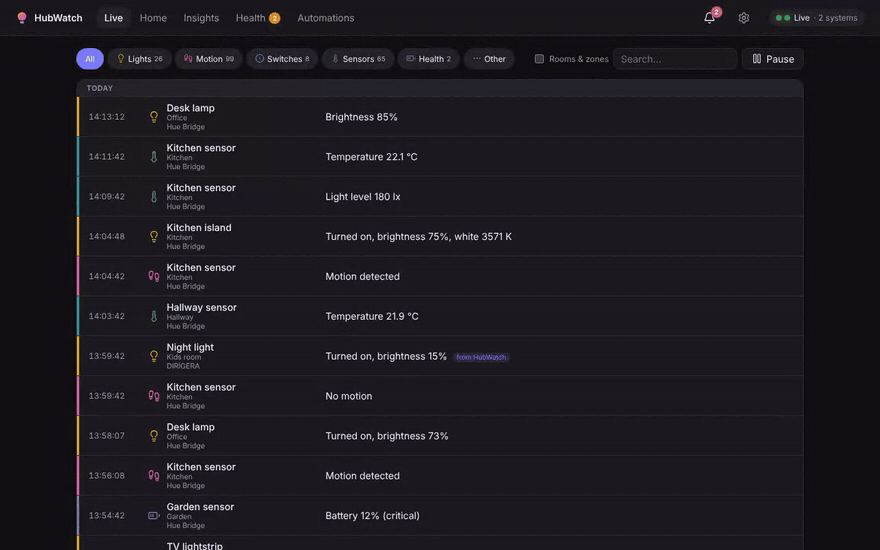
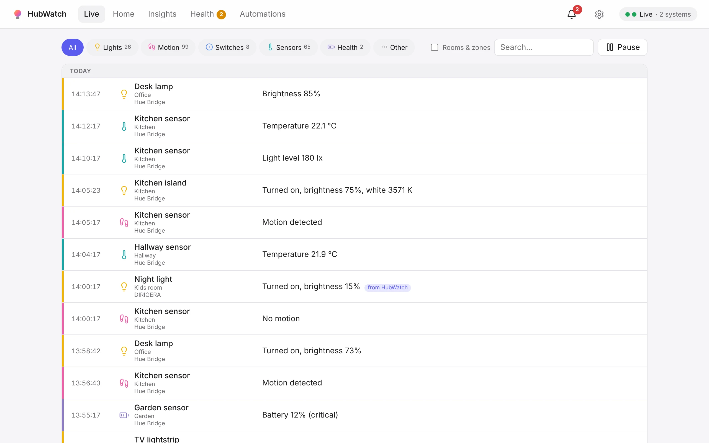
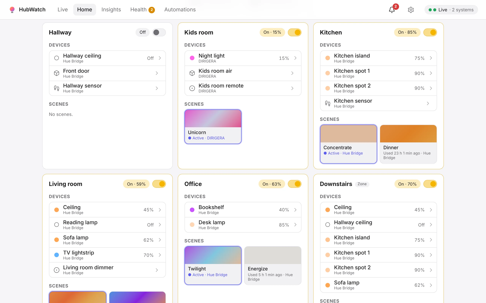
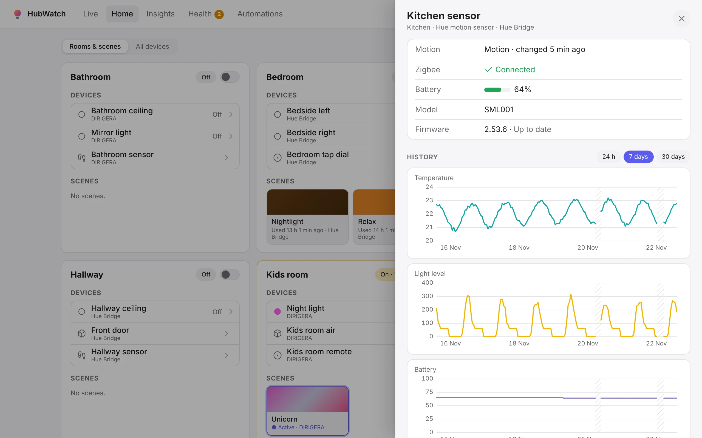
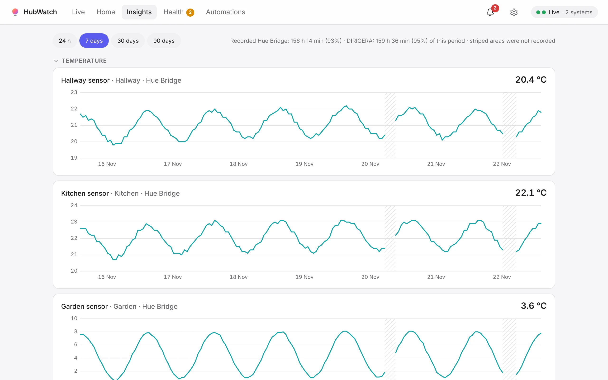
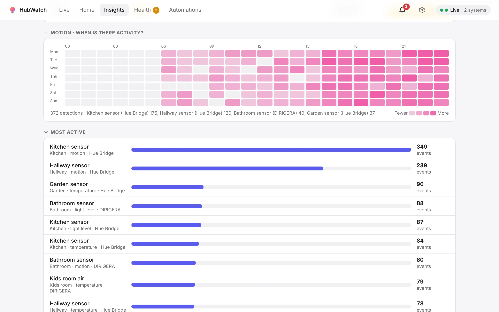
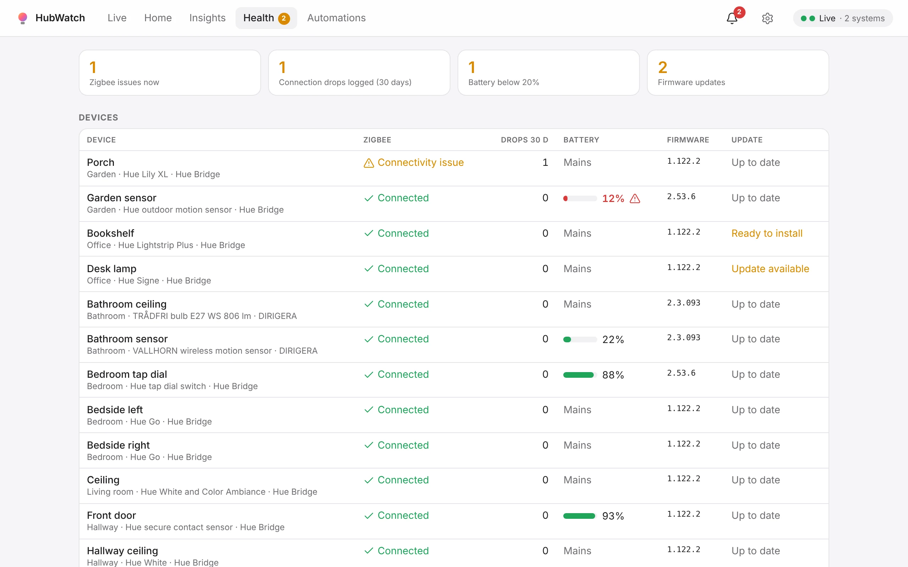
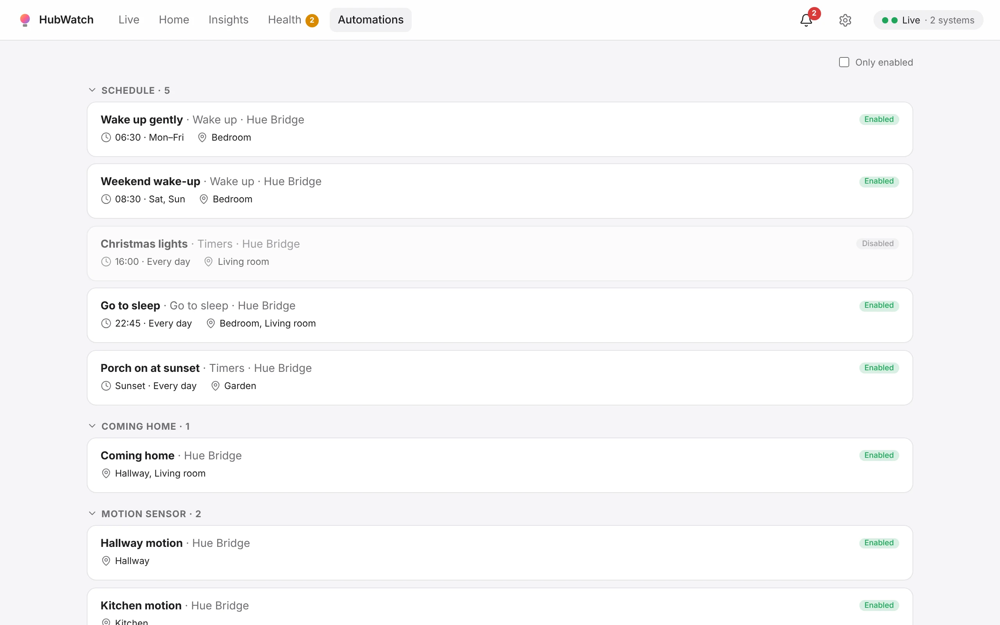

# HubWatch

<p align="center">
  
  <br>
  <a href="#screenshots">More screenshots ↓</a>
</p>

A free, open-source web app that records and shows a **real-time log of everything that happens in your smart home**: lights turning on and off, motion, switch presses, temperature, light level, battery and connectivity health. Works with **Philips Hue** and **IKEA DIRIGERA**, and records several systems at the same time.

Everything runs locally on your own computer and talks directly to your Hue Bridge or DIRIGERA hub. No cloud, no account and no tracking.

> **Good to know:** neither the Hue Bridge nor the DIRIGERA hub keeps any history itself. HubWatch records events **while it is running**. Periods when the app was closed are shown clearly as gaps in the log. On Hue it also picks up, at startup, the *last* motion, button press and so on that each sensor reported while it was closed.

## Features

- Live event log with filters (lights, motion, switches, sensors, health), search and day headers
- Raw JSON for every event (click a row)
- Device overview by room: on/off and brightness, motion, temperature, lux, contact, battery, Zigbee status
- Climate charts: temperature and light level per sensor over 24 h, 7 or 30 days, with periods when nothing was recorded marked
- Health view: Zigbee connectivity now and its history, battery levels, firmware and available updates
- Device timeline: click any device for its full event history and charts
- Rooms & scenes: every room and zone with its lights in their current color, and scenes shown as color palettes (active scene and when each was last used)
- Switch lights, rooms and zones on and off from the room cards or a device's details. Changes made from HubWatch are marked "from HubWatch" in the log
- Statistics: how long each light was on per day, how often it was switched on, a weekday × hour motion heatmap and the most active devices
- Alerts: low battery, devices unreachable, bridge unreachable. Shown in the app, as browser notifications, and optionally on your phone via [ntfy](https://ntfy.sh)
- Automations (Philips Hue): Hue app automations (wake-ups, schedules, motion sensor behaviours), plus the bridge's classic rules and schedules in readable "if … then …" form
- Guided setup: for Hue it finds your bridge automatically; for IKEA DIRIGERA you enter the hub's address. Both pair with a single button press
- Local SQLite database. Your history stays on your machine

Several systems — Philips Hue bridges and IKEA DIRIGERA hubs — can be recorded at the same time.

Planned: bridge capacity, data export, DIRIGERA automations and energy metering, running as an always-on background service.

## Screenshots

<sup>The screenshots show a made-up demo home. They follow your GitHub light/dark setting.</sup>

**Live log** — Everything that happens, as it happens: filter by type, search, and click a row for the raw JSON.

<picture>
  <source media="(prefers-color-scheme: dark)" srcset="docs/screenshots/live-log-dark.webp">
  
</picture>

**Rooms & scenes** — Every room and zone with its lights in their current color, scenes as color palettes, and on/off switches.

<picture>
  <source media="(prefers-color-scheme: dark)" srcset="docs/screenshots/rooms-dark.webp">
  
</picture>

<details>
<summary><b>More screenshots</b>: device details, climate charts, statistics, health and automations</summary>

**Device details** — Click any device for its status, full event history and charts.

<picture>
  <source media="(prefers-color-scheme: dark)" srcset="docs/screenshots/device-dark.webp">
  
</picture>

**Climate charts** — Temperature and light level per sensor. Striped areas are periods when HubWatch was not running.

<picture>
  <source media="(prefers-color-scheme: dark)" srcset="docs/screenshots/insights-dark.webp">
  
</picture>

**Statistics** — When there is movement in the home, how long each light is on and which devices are most active.

<picture>
  <source media="(prefers-color-scheme: dark)" srcset="docs/screenshots/statistics-dark.webp">
  
</picture>

**Health** — Zigbee connectivity, connection drops, battery levels and firmware updates at a glance.

<picture>
  <source media="(prefers-color-scheme: dark)" srcset="docs/screenshots/health-dark.webp">
  
</picture>

**Automations** — Hue app automations and the bridge's own rules and schedules, in readable form.

<picture>
  <source media="(prefers-color-scheme: dark)" srcset="docs/screenshots/automations-dark.webp">
  
</picture>

</details>

## Install

### Mac: Homebrew (recommended)

If you have [Homebrew](https://brew.sh):

```bash
brew install andemt/tap/hubwatch
ln -sfn "$(brew --prefix)/opt/hubwatch/HubWatch.app" /Applications/HubWatch.app
```

Then open HubWatch from your Applications folder. Update with `brew upgrade hubwatch`; the link keeps pointing at the latest version.

Prefer the terminal? `hubwatch` starts the server alone and opens your browser at <http://localhost:5080>, and `brew services start hubwatch` records in the background, also after a restart. The app uses a server that is already running, so the two work together.

### Download (no technical knowledge needed)

1. Download the file for your computer from [Releases](../../releases):
   - **Mac (Apple Silicon M1–M4):** `HubWatch-…-osx-arm64.zip`
   - **Mac (Intel):** `HubWatch-…-osx-x64.zip`
   - **Windows:** `HubWatch-…-win-x64.zip`
   - **Linux / Raspberry Pi:** `…-linux-x64.tar.gz` / `…-linux-arm64.tar.gz`
2. **Mac:** unzip it and drag **HubWatch.app** to your Applications folder, then open it.
   **Windows and Linux:** unpack the whole archive into a folder and start **HubWatch** (`HubWatch.exe` on Windows). Keep the files next to it (such as the `wwwroot` folder) together with the app.
3. HubWatch opens (on Mac and Windows in its own window, on Linux in your browser at <http://localhost:5080>). For Philips Hue, pick your bridge and press the round link button on top of it. For IKEA DIRIGERA, enter the hub's address and press the action button underneath it. Done — more systems can be added later in Settings.

On Mac and Windows, closing the window keeps HubWatch recording in the background. Open it again or quit from the HubWatch icon in the menu bar (Mac) or the taskbar's notification area (Windows). On Mac, **Open at Login** in that menu starts HubWatch with your Mac.

Nothing else needs to be installed. The download contains everything.

**macOS says the app "cannot be opened"?** The app is not signed by Apple (that requires a paid Apple developer account). Open **System Settings → Privacy & Security**, scroll down and click **Open Anyway** next to HubWatch. Or run once in Terminal: `xattr -dr com.apple.quarantine /Applications/HubWatch.app` Installing with Homebrew avoids this.

**Windows SmartScreen warning?** Click **More info → Run anyway**.

### Where is my data?

| OS | Folder |
|---|---|
| macOS | `~/Library/Application Support/HubWatch` |
| Windows | `%LOCALAPPDATA%\HubWatch` |
| Linux | `~/.local/share/HubWatch` |

Change it with `--DataDir=/some/folder`. Other options: `--urls=http://0.0.0.0:5080` (allow other devices on your network, such as your phone) and `--no-browser`.

## Development

Requirements: .NET 11 SDK, Node.js 22+ and pnpm.

```bash
dotnet watch --project src/HubWatch.Server          # API + collector on :5080
cd src/HubWatch.Web && pnpm install && pnpm dev      # UI on :5173
```

See **[CONTRIBUTING.md](CONTRIBUTING.md)** for the full setup, project structure, how the Hue and DIRIGERA integrations work, conventions and releasing.

## Contributing

Issues and pull requests are welcome. Start with [CONTRIBUTING.md](CONTRIBUTING.md). If you work with an AI coding assistant, it will pick up [AGENTS.md](AGENTS.md). Philips Hue API documentation: <https://developers.meethue.com/develop/hue-api-v2/>

Not affiliated with Signify, Philips Hue, IKEA or Inter IKEA Systems B.V. "Philips Hue" is a trademark of Signify. "IKEA" and "DIRIGERA" are trademarks of Inter IKEA Systems B.V.

## License

MIT
